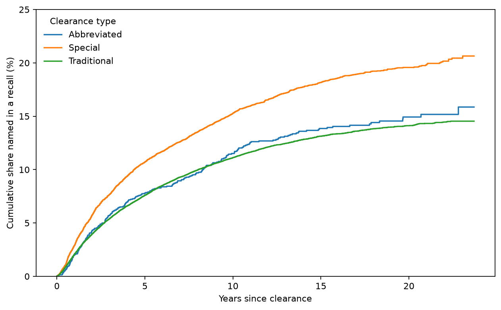
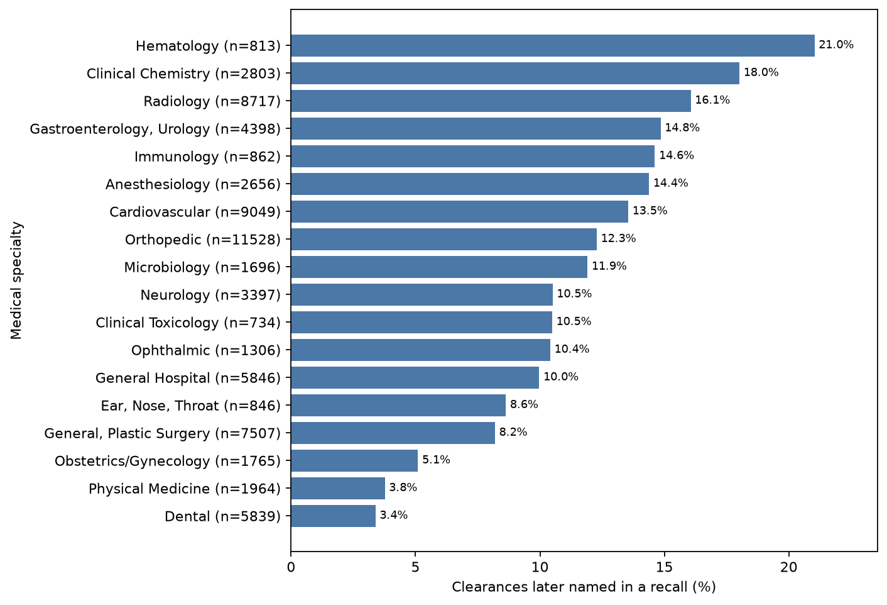
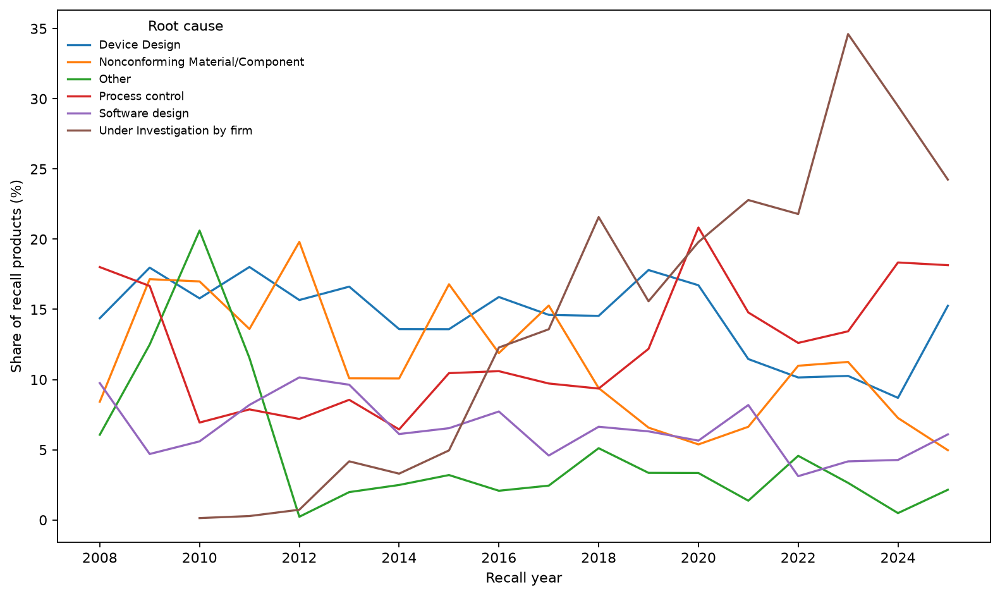
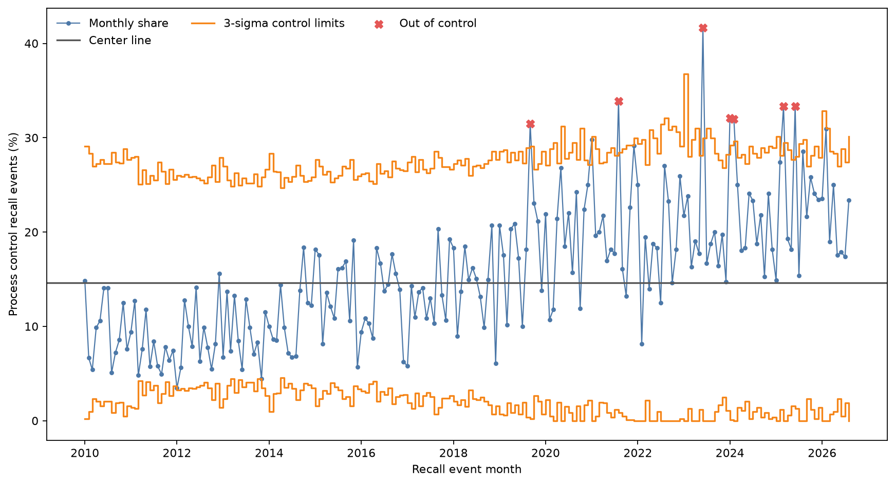

# FDA Device Recall Warehouse

This project builds a small DuckDB warehouse from openFDA device recall, 510(k), and device classification bulk exports. It prepares a frozen 510(k) survival cohort, descriptive marts, a SQL Kaplan–Meier estimate, a Cox model, CSV exports, and static figures.

## Run

Use Python 3.14 with the pinned packages in `requirements.txt`. To download the source archives when they are not already in `data/raw/`, run:

```sh
make fetch
```

Build all outputs from local archives:

```sh
make all
make test
```

Individual targets are `load`, `sql`, `cox`, `export`, `figures`, and `test`.

## SPEC limits

- Recalls without a K number are invisible to the join (lower-bound rates).
- A recall is a firm's corrective action, not a measure of patient harm.
- PMA and De Novo devices are outside the cohort.
- Special 510(k)s are modifications to a firm's own cleared device, so firms that file them differ from firms that do not. This is association, not a causal effect of the pathway.
- One recall event can cover many products and many K numbers.

## Results

All numbers come from the 2026-10-02 openFDA export and reproduce with `make all`.

**Cohort.** 73,432 510(k) clearances decided from 2003-01-01 to 2026-09-14. 8,403 of them
(11.4%) were later named in at least one recall.

**Clearance type.** Special 510(k)s are recalled more often and sooner than Traditional ones,
and the gap survives adjustment.

| Clearance type | Clearances | Later recalled | Recalled within 5 years (Kaplan-Meier) | Within 10 years |
|---|---:|---:|---:|---:|
| Traditional | 57,684 | 10.4% | 7.6% | 11.1% |
| Special | 13,637 | 15.5% | 10.7% | 15.3% |
| Abbreviated | 2,111 | 12.6% | 7.8% | 11.5% |

Cox model, stratified by medical specialty and adjusted for device class and decision year
(71,790 clearances): the hazard ratio for Special against Traditional is **1.28 (95% CI 1.21
to 1.34)**. Under the rule frozen in `SPEC.md` the difference counts as real, because the
interval excludes 1. Abbreviated against Traditional is 1.11 (0.98 to 1.26), which does not.



This is an association. A Special 510(k) is a change to a device the firm already sells, so a
firm filing one has, by construction, a product on the market long enough to be modified, and
often a product family that shares one recall.

**Device class and specialty.** Class III devices cleared through 510(k) are recalled far more
often (33.5% of 245) than Class II (11.9%) or Class I (4.9%). Among specialties with at least
500 clearances, Hematology (21.0%), Clinical Chemistry (18.0%) and Radiology (16.1%) are
highest; Dental (3.4%) and Physical Medicine (3.8%) are lowest.



**Root causes.** Since 2003 the most common coded cause is Device Design (13.0% of recalled
products), ahead of Process Control (11.1%) and Nonconforming Material/Component (10.1%).
Software Design is 5.9% and has stayed between 3% and 10% a year since 2008. Two cautions
shape how far this can be read: root causes were rarely coded before 2008, and "Under
Investigation by firm" has grown from under 1% of recalled products in 2012 to 24% in 2025,
so recent shares for every named cause are understated.



**Process control chart.** `sql/11_mart_process_control_pchart.sql` builds a p-chart of the
monthly share of recall events whose firm-reported root cause is "Process control", from January
2010 to August 2026 (200 months, 13,952 events with an informative root cause). Each recall event
counts once. Events coded "Other", "Under Investigation by firm" or "Unknown/Undetermined by firm"
are left out of the denominator.

The center line is 14.6%, but a single center line does not describe this process. The share
roughly doubled, from about 9% a year in 2010-2013 to 21-24% in 2021-2025. Before 2018, 81 of 96
months sit below the center line; from 2018 on, 88 of 104 sit above it. The run rule (eight or more
months in a row on one side) flags 87 months, and 7 months fall above the upper 3-sigma limit, all
between 2019 and 2025. In SPC terms this is a sustained shift, not random variation around a stable
rate. The chart cannot say why. Manufacturing problems may have grown, or firms may label causes
differently now; the growth of "Under Investigation by firm" (see above) is one sign that coding
practice changed over the same period.



**Model check.** The proportional-hazards test flags decision year and device class. For
Special 510(k)s the two test variants disagree (p = 0.68 and p < 0.005). With 72,000
observations small departures are detectable, and the curves above do not cross, so the hazard
ratio is best read as an average over follow-up. Full output: `reports/cox_ph_check.txt`.

**Data quality** (`exports/dq_report.csv`).

| Check | Count |
|---|---:|
| Recall rows with no K number (cannot be linked) | 20,585 of 59,344 |
| Recall links dated before the clearance they cite (dropped) | 155 |
| Recall dates that could not be parsed (set to NULL) | 21 |
| Recalled K numbers absent from the 510(k) file | 6 |
| 510(k) rows with no classification match | 1,644 |

## Dashboard

`exports/*.csv` feed a Tableau Public dashboard (in progress).
